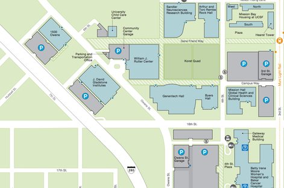
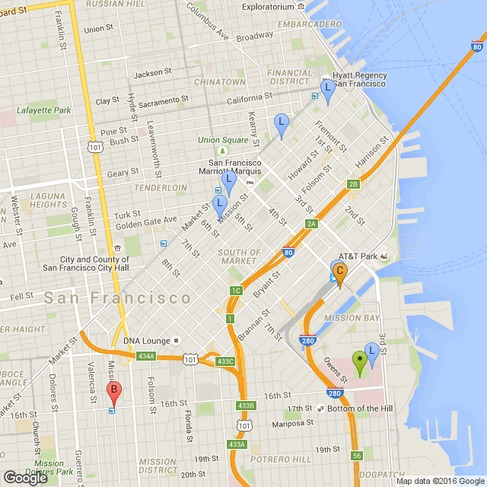
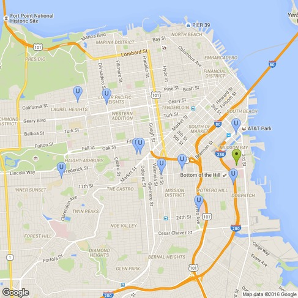

## directions

##
Campus map

We are located on the on the 3rd floor of Byers Hall at the intersection of 4th St. and 16th St. on the UCSF Mission Bay campus. Byers Hall is adjacent/connected to Genentech Hall. Tanja's office is on the third floor in room 308E, and the lab is in 309.

## Public transport

The Mission Bay campus is served by bus, light rail, and UCSF shuttles and is located close to Caltrain.

Public transport

**Light rail (L)**

The K/T light rail line can be taken from any downtown BART station (Civic Center, Powell, Montgomery, Embarcadero) or from 4th and King Caltrain station. The Mission Bay stop is a three minute walk from Byers Hall (•) where the lab is located.

**Caltrain (C)**

If you are traveling by Caltrain, the closest stop is 4th and King. From there, the light rail can be taken to the Mission Bay stop. Alternatively, it is a 15-20 minute walk from the Caltrain station to Byers Hall.

**Bus / shuttle (B)**

The 55 bus line (B) has a direct connection from 16th and Mission BART station to Byers Hall. The bus stop is located on the south-west side of the intersection.

The [UCSF Red shuttle](http://campuslifeservices.ucsf.edu/transportation/services/shuttles/routes_timetables) can also be taken from 16th and Mission on the north-east side of the intersection (outside Burger King).

## UCSF shuttles

Public transport

UCSF provides free shuttles between the campuses for faculty, staff, students, patients, and visitors.

The routes and timetables are available [here](http://campuslifeservices.ucsf.edu/transportation/services/shuttles/routes_timetables). Some of the main campuses are marked in the map to the left (U) with Mission Bay marked as (•).

​

## From SFO airport

*[BART from SFO (@60-minute trip by public transport)](https://www.google.com/maps/dir/San+Francisco+Airport,+San+Francisco,+CA/1700+4th+Street,+San+Francisco,+CA/@37.6923133,-122.4950598,12z/data=!3m1!4b1!4m14!4m13!1m5!1m1!1s0x808f778c55555555:0xa4f25c571acded3f!2m2!1d-122.3789554!2d37.6213129!1m5!1m1!1s0x808f7fcf444da87f:0x1760faed340b1c4a!2m2!1d-122.3914712!2d37.767294!3e3?hl=en):* Take any train going to San Francisco and depart at 16th and Mission BART station. The fare should be under $10 (up-to-date information can be found on the [BART website](https://www.bart.gov/tickets/calculator)). Return fares are the same price. Taxis from SFO should take approximately 25 minutes outside of peak commuting hours.

## From OAK airport

*[BART from OAK (@80-minute trip by public transport)](https://www.google.com/maps/dir/Oakland+International+Airport,+Airport+Access+Road,+Oakland,+CA/1700+4th+Street,+San+Francisco,+CA/@37.7687677,-122.3760075,12z/data=!3m1!4b1!4m14!4m13!1m5!1m1!1s0x808f85a1afd46a6d:0xab2406be1f4f1879!2m2!1d-122.1986718!2d37.7277069!1m5!1m1!1s0x808f7fcf444da87f:0x1760faed340b1c4a!2m2!1d-122.3914712!2d37.767294!3e3?hl=en):* Take the AirBART from the airport to the Coliseum BART station (free service). From Coliseum, buy a BART ticket (@$4), take any train going to San Francisco, and depart at Embarcadero station. From Embarcadero, take the K/T line to Mission Bay. Taxis from SFO should take approximately 35-40 minutes outside of peak commuting hours. During peak times, the Bay Bridge connecting San Francisco and Oakland can get congested. Note that there is a toll to cross the Bay Bridge if you are traveling by car.
