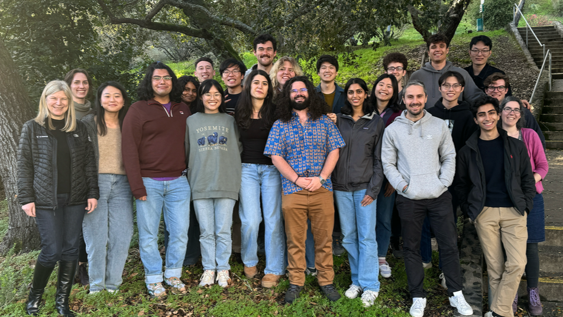
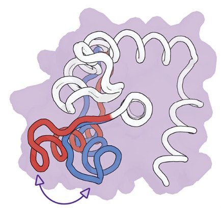

**Engineered biological systems, ranging from molecules with new functions to entire organisms, have tremendous practical importance; they can also fundamentally change how we ask questions about the biological principles of function and fitness. Our research aims to invent approaches to engineer new molecules that operate as predicted in biological contexts, and to utilize prediction and engineering to address fundamental questions on the relationship of molecular characteristics, cellular function and organismal fitness. To address the many current challenges in the field – from developing more predictive computational design methods to determining the requirements for function in cells – we combine concepts from computer science, physics, chemistry, mathematics, engineering and biology.**​
​

## Selected Publications

<!-- featured_publications -->

## Perspectives and Reviews

<!-- featured_reviews -->

## Highlights from the Lab

Amy’s work on designing dynamic proteins:

[An Artificial Protein that Moves Like Something Found in Nature - UCSF](https://www.ucsf.edu/news/2025/05/430036/artificial-protein-moves-something-found-nature)

[Scientists design proteins that can change their shapes - C&EN](https://cen.acs.org/physical-chemistry/protein-folding/Scientists-design-proteins-change-shapes/103/web/2025/05)

[AI-Designed Protein Moves Mimics Natural Movement - Genetic Engineering and Biotechnology News](https://www.genengnews.com/topics/artificial-intelligence/ai-designed-protein-moves-mimics-natural-movement/)

[Designer protein switches conformations like a natural one - Chemistry World](https://www.chemistryworld.com/news/designer-protein-switches-conformations-like-a-natural-one/4021553.article)
​
